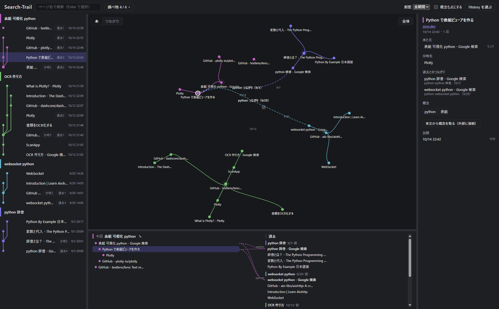
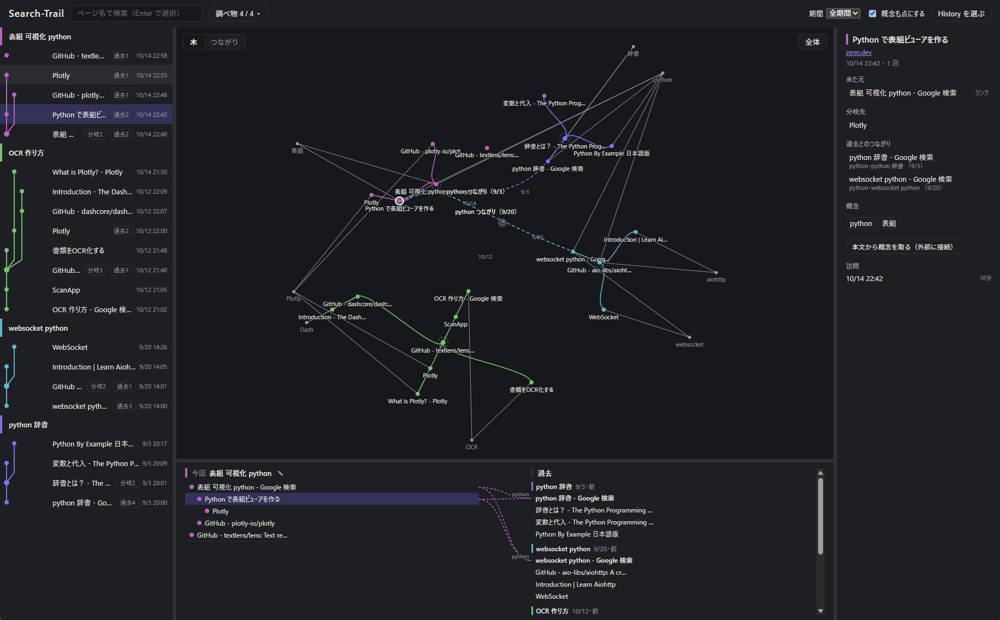
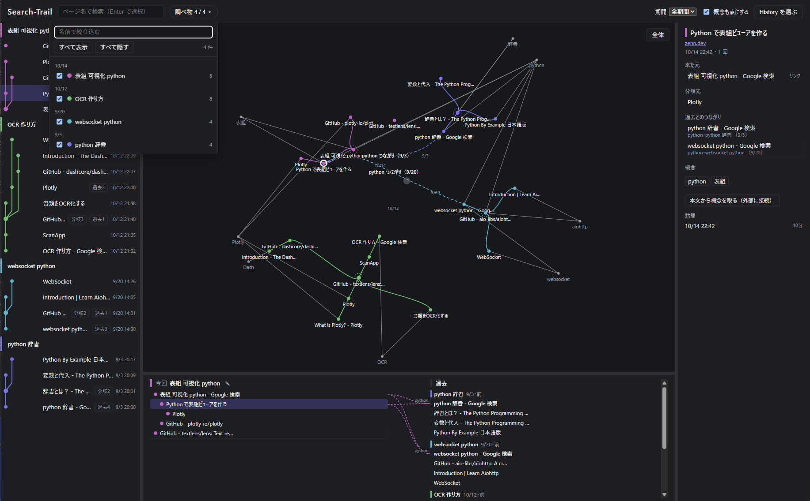

# Search-Trail

[日本語](README.md) | English

A personal tool that turns your Chrome browsing history into a graph, showing **how each piece of research branched out and how it connects to things you looked up before**.

It was built to answer questions like "What was I researching back then, and which pages did I go through?" and "How does today's research relate to what I looked into earlier?"

> [!WARNING]
> **This is an early-stage prototype, and the project has been abandoned.**
> It was built to try out an idea. No further updates, bug fixes, or support are planned. It has only been tested on the author's machine (Windows). It is published as-is for reference.



> The screenshots use fictional history created for testing.

The user interface is in Japanese only.

## Features

- **Splits history into research sessions**: Visits are grouped into "research sessions" based on where each page was opened from (the referring page) and the time gaps between visits.
- **Shows how research branched**: Each session is drawn as a tree, and all trees are arranged in a radial forest spreading out from the center. Session roots are placed clockwise in date order.
- **Shows links to past research**: "Concepts" (words such as Python or OCR) are extracted from search terms and page titles. Sessions that share a concept or a page are linked.
  - In the "Tree" (木) view, links from the selected page are drawn as curves bundled along the tree trunks.
  - In the "Links" (つながり) view, sessions are listed one per row, and linked sessions are connected with arcs.
- **Four linked panes**: Select a page in any pane (history log, graph, current vs. past, details), and the other panes select it too.
- **Handles large histories**: When there are more than 2,000 nodes, the graph is drawn with WebGL (GPU-accelerated rendering).

## Privacy

Browsing history is highly personal, so the app is designed as follows.

- **Nothing is saved**: Imported history and analysis results live only in the server's memory. Nothing is written to disk, and everything is gone when you stop the app. The location of the History file you choose is not remembered either.
- **Nothing is sent out**: The server only listens on `127.0.0.1` (your own PC). Other computers cannot connect to it.
- **One exception**: Only when you press "Extract concepts from page text" (本文から概念を取る) in the details pane does the app connect to the internet, to fetch that one page.
- **Your original file is never modified**: Chrome's History file is copied to a temporary folder, and only the copy is read.

## Requirements

| What | Used for | How to install |
| --- | --- | --- |
| [uv](https://docs.astral.sh/uv/) | Managing Python and packages (Python 3.12 is installed automatically) | Follow the official instructions |
| [Node.js](https://nodejs.org/) 22 or later | Building the user interface (only on first run and after updates) | Official installer |
| Google Chrome | Source of the browsing history | — |

The app has been tested on Windows. Automated tests also pass on macOS and Linux.

## Usage

### 1. Start the app

First, clone this repository.

```sh
git clone <URL of this repository>
cd Search-Trail
```

Then run the start script.

| OS | How to start |
| --- | --- |
| Windows | Double-click `start.cmd` in the folder |
| macOS / Linux | Open a terminal in this folder and run `./start.sh` |

- A terminal window opens and keeps running. **Do not close it while you are using the app.**
- On the first run, downloading packages and building the user interface takes 1–2 minutes.
- When it is ready, `http://127.0.0.1:8765/` opens in your browser automatically.
  - If it does not open, type this address into your browser.

If you are comfortable with the terminal, these two lines do the same thing:

```sh
cd backend
uv run tadori start
```

Options:

| Option | Meaning |
| --- | --- |
| `--port 9000` | Use a different port if 8765 is already used by another app |
| `--no-browser` | Do not open the browser automatically |

Example: `uv run tadori start --port 9000` (the start scripts accept the same options, e.g. `start.cmd --port 9000`)

### Stopping the app

Do one of the following:

- Press `Ctrl+C` in the terminal window
- Close the terminal window

Closing the browser tab does not stop the app.

When the app stops, all imported history and analysis results are erased (nothing is left on disk). Next time, start the app again and choose the History file again.

### 2. Choose the History file

Press "Choose History" (History を選ぶ) and select Chrome's `History` file. If there is a `History-wal` file in the same folder, select it as well to include the most recent visits.

| OS | Location of the History file |
| --- | --- |
| Windows | `%LOCALAPPDATA%\Google\Chrome\User Data\Default\History` |
| macOS | `~/Library/Application Support/Google/Chrome/Default/History` |
| Linux | `~/.config/google-chrome/Default/History` |

- On Windows, you can paste the path above into the "File name" box of the file dialog.
- If you use multiple Chrome profiles, `Default` may be `Profile 1` or similar.

Since history is not saved, you choose the file again every time you start the app.

#### Trying it without your own history

You can create a fictional history for testing (4 research sessions, 28 visits).

```sh
cd backend
uv run python -m tests.fixtures.make_fake_history ../data/demo/History
```

This creates `data/demo/History`. Select it with "Choose History". The `data/` folder is excluded from Git.

### 3. Explore

- **Top bar**: Search by page name, show or hide sessions (調べ物 ▾), choose a period, and "Show concepts as nodes" (概念も点にする)
- **Left (history log)**: Visits grouped by session, newest first
- **Center (graph)**: Switch between "Tree" (木) and "Links" (つながり) at the top left. Double-click a node to open the original page.
- **Bottom (current vs. past)**: The tree of the selected session, side by side with related past sessions
- **Right (details)**: Referring page, branches, links to the past, concepts, and visit times
- Drag the borders between panes to resize them. Double-click a border to reset it.

With "Show concepts as nodes" turned on, concepts (gray nodes) are connected to the pages they appear in.



Press "Sessions ▾" (調べ物 ▾) to open the list of sessions. You can filter by name and use the checkboxes to show or hide each session.



## Limitations

- **Only about 90 days of history**: Chrome keeps only about 90 days of history in the History file on your PC. Search-Trail does not store history either, so older visits cannot be shown.
- **Chrome only**: History from other browsers cannot be read.
- **Synced visits are skipped**: Visits synced from other devices, such as your phone, are not included in sessions, because their referring pages are unknown.
- **Referring pages may be estimated**: When Chrome has no record of where a page was opened from, the app estimates it from timing and other clues. The reason for each estimate can be checked in the details pane.

## For developers

To work on the user interface, run the API and the UI separately (UI changes are reflected as soon as you save).

```sh
# Terminal 1: API (127.0.0.1:8765)
cd backend
uv run tadori serve

# Terminal 2: UI (127.0.0.1:5173)
cd frontend
npm install
npm run dev
```

To run the tests (they use fictional History data, never real browsing history):

```sh
cd backend && uv run pytest
cd frontend && npm test
```

| Folder | Contents |
| --- | --- |
| `backend/` | Import, analysis, and API (Python 3.12, FastAPI, in-memory SQLite, SudachiPy) |
| `frontend/` | User interface (Vite, Vue 3, TypeScript, Pinia, sigma.js) |

Some code comments refer to design documents (such as `docs/07`) that are not included in this repository.

## License

Released under the [MIT License](LICENSE).
