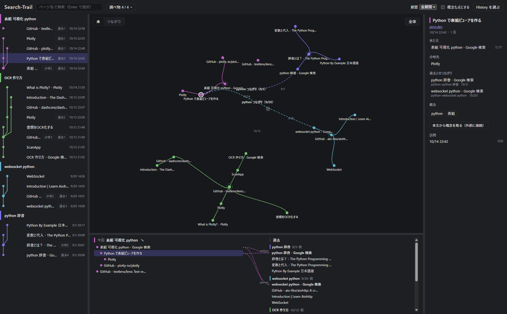
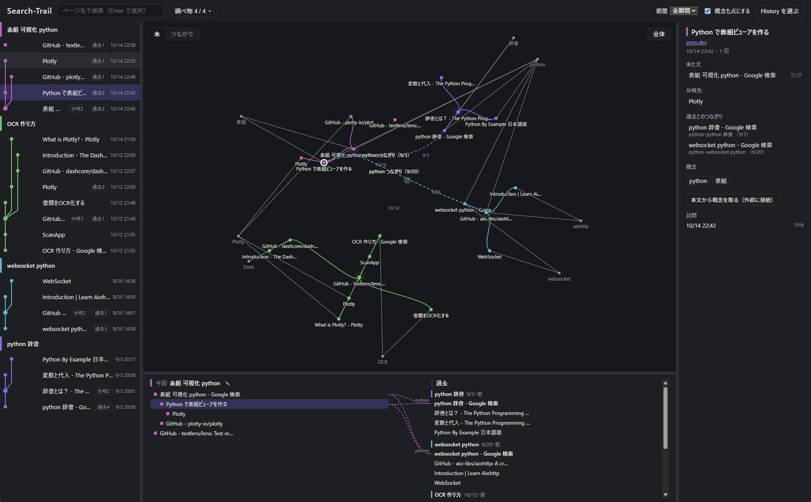
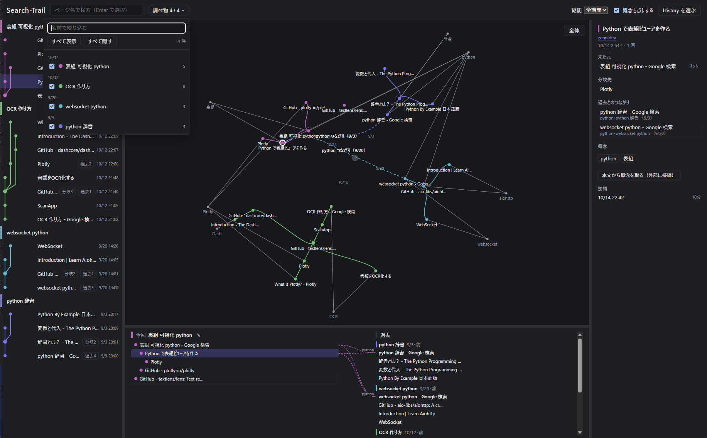

# Search-Trail

日本語 | [English](README.en.md)

Chrome の閲覧履歴から、**調べ物がどう枝分かれし、過去の調べ物とどうつながったか**を、グラフで見られる自分用のアプリです。

「あのとき何を調べていて、そこからどのページへ進んだのか」「今日の調べ物は、前に調べた何とつながっているのか」をたどるために作りました。

> [!WARNING]
> **これは試作段階のプロトタイプで、開発を取りやめた没案です。**
> アイデアを確かめるために作ったもので、今後の更新や不具合の修正、質問への対応は予定していません。動作の確認も作者の環境（Windows）でしかしていません。参考として、そのまま公開しています。



> 画面の例は、テスト用に作った架空の履歴です。

## できること

- **調べ物に分ける**：訪問を、来た元（どのページから開いたか）と時間の空き具合から、ひとまとまりの「調べ物」に分けます。
- **枝分かれを見る**：調べ物ごとの木を、中心から外へ広がる形（放射状の森）で描きます。出発点は日付順に時計回りに並びます。
- **過去とのつながりを見る**：検索した言葉やページのタイトルから「概念」（Python、OCR などの言葉）を取り出します。同じ概念や同じページを持つ過去の調べ物とつなぎます。
  - 「木」の表示では、選んだページのつながりを、木の幹に沿った曲線で描きます。
  - 「つながり」の表示では、調べ物を1行ずつ並べ、つながった調べ物どうしを弧で結びます。
- **4つの領域が連動する**：履歴ログ・グラフ・今回と過去・詳細のどこでページを選んでも、ほかの領域も同じページを選んだ状態になります。
- **大きな履歴にも対応**：点が2,000を超えると、WebGL（画面の描画を速くする仕組み）で描きます。

## プライバシーについて

閲覧履歴は個人情報のかたまりなので、次のように作っています。

- **保存しない**：取り込んだ履歴と解析結果は、サーバーのメモリの中にだけ置きます。ディスクには書かず、アプリを止めると消えます。選んだ History ファイルの場所も覚えません。
- **外へ送らない**：サーバーは `127.0.0.1`（自分の PC）でだけ待ち受けます。ほかの PC からはつながりません。
- **例外は1つだけ**：詳細の欄で「本文から概念を取る」を押したときだけ、そのページを取りに外へ通信します。
- **元のファイルを書き換えない**：Chrome の History ファイルは一時フォルダにコピーし、コピーだけを読みます。

## 必要なもの

| もの | 用途 | 入れ方 |
| --- | --- | --- |
| [uv](https://docs.astral.sh/uv/) | Python と部品の管理（Python 3.12 も自動で入ります） | 公式サイトの手順 |
| [Node.js](https://nodejs.org/) 22 以上 | 画面の組み立て（初回と、更新したときだけ） | 公式サイトのインストーラー |
| Google Chrome | 閲覧履歴の元 | — |

動作の確認は Windows で行っています。macOS と Linux でも、自動テストは通っています。

## 使い方

### 1. 起動する

まず、このリポジトリを手元にコピー（クローン）します。

```sh
git clone <このリポジトリの URL>
cd Search-Trail
```

次に、起動用のファイルを実行します。

| OS | 起動のしかた |
| --- | --- |
| Windows | フォルダの中の `start.cmd` をダブルクリック |
| macOS / Linux | ターミナルでこのフォルダに移り、`./start.sh` を実行 |

- 黒い画面（ターミナル）が開き、そのまま動き続けます。**アプリを使っている間は、この画面を閉じないでください。**
- 初回だけ、部品のダウンロードと画面の組み立てに1〜2分かかります。
- 準備が終わると、ブラウザで `http://127.0.0.1:8765/` が自動で開きます。
  - 開かないときは、このアドレスを自分でブラウザに入力してください。

ターミナルに慣れている人は、次の2行でも同じことができます。

```sh
cd backend
uv run tadori start
```

起動のときに使えるオプションは次のとおりです。

| オプション | 意味 |
| --- | --- |
| `--port 9000` | 8765 番がほかのアプリで使われているときに、別の番号で開く |
| `--no-browser` | ブラウザを自動で開かない |

例：`uv run tadori start --port 9000`（`start.cmd --port 9000` のように、起動用のファイルにも付けられます）

### 終了する

次のどちらかで終了します。

- 黒い画面（ターミナル）で `Ctrl+C` を押す
- 黒い画面（ターミナル）をそのまま閉じる

ブラウザのタブを閉じただけでは、アプリは止まりません。

終了すると、取り込んだ履歴と解析結果はすべて消えます（ディスクには何も残りません）。次に使うときは、もう一度起動して History ファイルを選び直してください。

### 2. History ファイルを選ぶ

画面の「History を選ぶ」を押し、Chrome の `History` ファイルを選びます。同じフォルダに `History-wal` があれば、一緒に選ぶと直近の訪問まで入ります。

| OS | History ファイルの場所 |
| --- | --- |
| Windows | `%LOCALAPPDATA%\Google\Chrome\User Data\Default\History` |
| macOS | `~/Library/Application Support/Google/Chrome/Default/History` |
| Linux | `~/.config/google-chrome/Default/History` |

- Windows では、ファイルを選ぶ画面の「ファイル名」の欄に上の場所を貼りつけると開けます。
- Chrome のプロフィールを複数使っている場合は、`Default` が `Profile 1` などになります。

履歴は保存しないので、アプリを起動するたびに選び直します。

#### 自分の履歴を使わずに試したいとき

テスト用の架空の履歴（4つの調べ物、28件の訪問）を作れます。

```sh
cd backend
uv run python -m tests.fixtures.make_fake_history ../data/demo/History
```

`data/demo/History` ができるので、画面の「History を選ぶ」でこのファイルを選んでください。`data/` フォルダは Git の管理の外にしてあります。

### 3. 見る

- **上の帯**：ページ名での検索、表示する調べ物の切り替え（「調べ物 ▾」）、期間、「概念も点にする」
- **左（履歴ログ）**：調べ物ごとの訪問を、新しい順に並べます。
- **中央（グラフ）**：左上の「木」「つながり」で表示を切り替えます。点をダブルクリックすると、元のページを開きます。
- **下（今回と過去）**：選んだ調べ物の木と、つながりのある過去の調べ物を並べます。
- **右（詳細）**：来た元、分岐先、過去とのつながり、概念、訪問の時刻を出します。
- 領域の境目はドラッグで大きさを変えられます。境目をダブルクリックすると元に戻ります。

「概念も点にする」をオンにすると、概念（灰色の点）と、その概念が出てくるページが線で結ばれます。



「調べ物 ▾」を押すと、調べ物の一覧が開きます。名前で絞り込み、チェックボックスで表示・非表示を切り替えられます。



## 知っておいてほしい制限

- **見られるのは約90日分**：Chrome はパソコンの中の History に約90日分しか残しません。Search-Trail も履歴を保存しないので、それより古い訪問は見られません。
- **Chrome だけ**：ほかのブラウザの履歴は読めません。
- **同期された訪問は使わない**：スマホなど、ほかの端末から同期された訪問は、来た元がわからないので調べ物に入れていません。
- **来た元は推定**：Chrome の記録に来た元が無いときは、時刻などから推定します。推定の理由は、詳細の欄で確かめられます。

## 開発する人へ

画面を直しながら試すときは、API と画面を別々に動かします（画面を保存するとすぐに反映されます）。

```sh
# ターミナル1: API（127.0.0.1:8765）
cd backend
uv run tadori serve

# ターミナル2: 画面（127.0.0.1:5173）
cd frontend
npm install
npm run dev
```

テストは次のとおりです。テストには、本物の履歴ではなく、テスト用に作った架空の History を使います。

```sh
cd backend && uv run pytest
cd frontend && npm test
```

| フォルダ | 中身 |
| --- | --- |
| `backend/` | 取り込み・解析・API（Python 3.12、FastAPI、SQLite をメモリの中で使用、SudachiPy） |
| `frontend/` | 画面（Vite、Vue 3、TypeScript、Pinia、sigma.js） |

## ライセンス

[MIT ライセンス](LICENSE) で公開しています。

- 著作権の表示（`LICENSE` の中身）を残せば、使う・改造する・配る・売るなど、自由に使えます。
- このソフトウェアは「そのまま」の状態で提供します。使って何か問題が起きても、作者は責任を負いません。

正式な条件は、英語で書かれた [LICENSE](LICENSE) のほうが優先されます。
